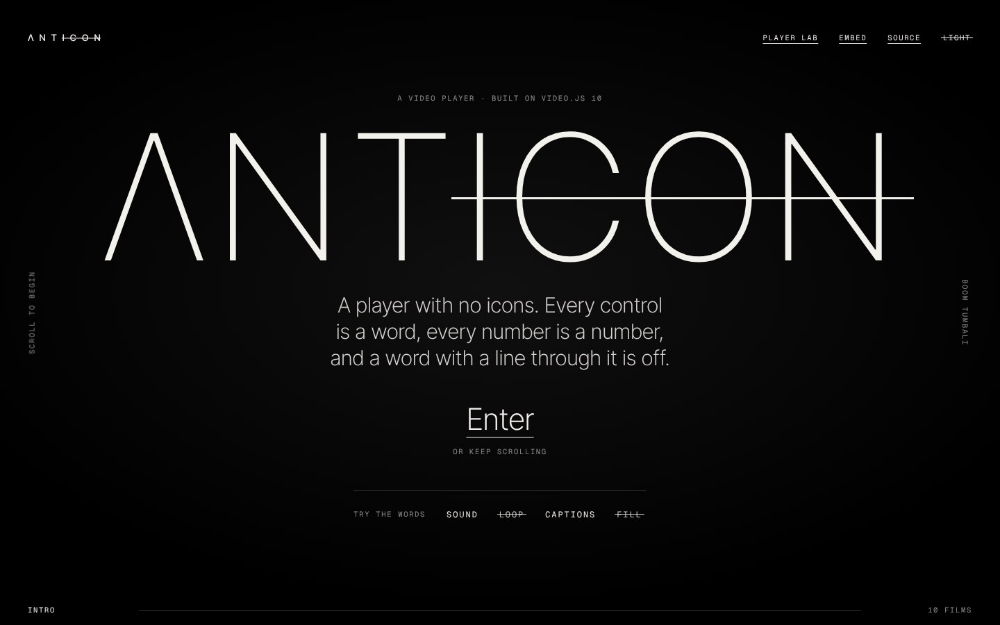
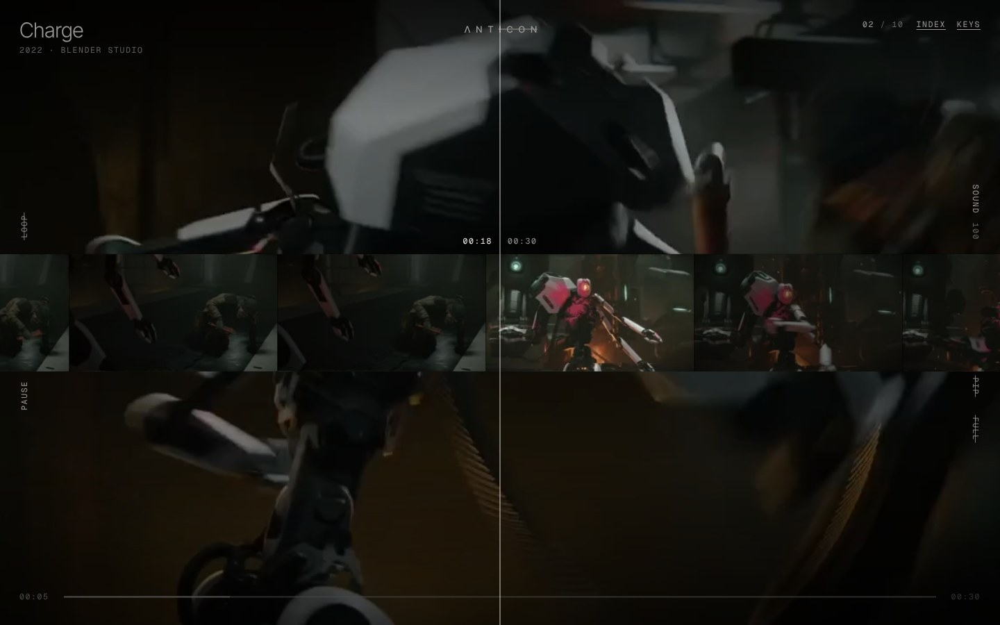
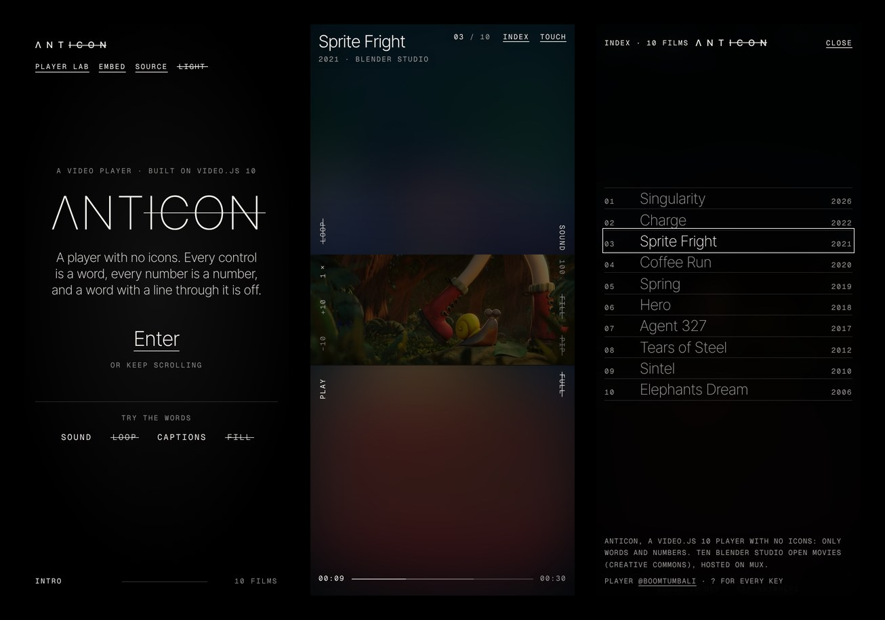
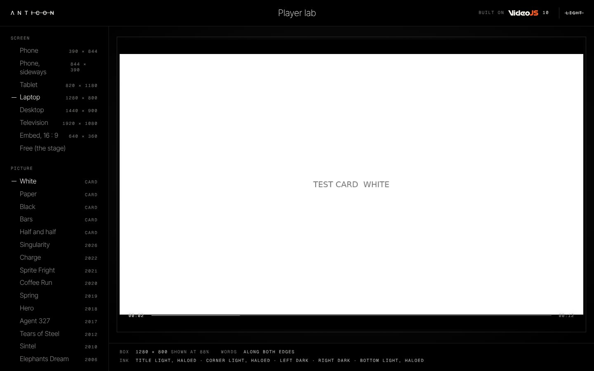

<p align="center"></p>

# ANTICON

**A video player without icons.** Every control is a word or a number, set in thin type. A control that can be on or off is a word: when it's off, a hairline runs through its middle; click it again and the line lifts. Progress is a single hairline with no knob. The words sit on the edges of the frame and run along each edge's own axis, so the player reads like a typographic poster rather than a toolbar.

Built on **Video.js 10** (`@videojs/react`) for the Video.js v10 Skins Challenge.

Player: [@boomtumbali](https://contra.com/boomtumbali)

**Live:** [anticon-boom.vercel.app](https://anticon-boom.vercel.app) · **Source:** [github.com/boomtumbali/anticon](https://github.com/boomtumbali/anticon)

---

## A look

**The start page.** Nothing plays until you choose. ICON is struck out, the way the player strikes out anything that is off.



**The feed.** Words on the edges of the frame, each along its own edge's axis; one hairline for progress.


**Scrubbing.** Drag the picture sideways, or point at or drag the progress line, and the film's own frames run across the middle as one continuous strip. The frame on the centre line is the moment you are pointing at.



**Moving between films.** The leaving film freezes on its frame and lifts away; the next rises with its name, a hairline on its leading edge.


**On a phone.** The start page, a film fitted with its own colours blurred around it, and the Index.



**The player lab.** Every screen size, and the pictures hardest to read over. On a white card, the edges switch to dark words by themselves.



## Pages

| Path | What it is |
| --- | --- |
| `/` | **The start page, then the feed.** Nothing plays on arrival. The start page says what ANTICON is, lets you try its on/off words, and lays out the ten films. Choose a film, press *Enter*, or scroll to the end of the page, and the player rises over it. A link with a film in it (`/#sprite-fright`) opens the feed on that film. |
| `/` (feed) | **The feed.** Ten Blender Studio films, newest first, one per screen, under one player that stays put, and they never run out: after Elephants Dream comes Singularity again, still moving down. A wheel turn, a swipe on a phone, or a pick from the Index moves to another film. Index and Credits open from the corners; ANTICON at the top goes back to the start page. |
| `/player/` | **The player lab.** One player put through the screens it will meet (phone upright and sideways, tablet, laptop, desktop, TV, a 16:9 embed, or the free stage) and the pictures that are hardest to read over (white, paper, black, bars, half and half), plus all ten films. A live readout shows the box size, how the words are laid out, how many are resting, and which ink each zone chose. |
| `/embed/` | **The player on a page.** The standalone player at 16:9, 9:16, 21:9 and 4:3, a thumbnail-width player, and the snippet to use it. |

Every page has a **Light** word in its header: a line through it while the page is dark (the default), no line when it is light. The choice is kept in the browser and shared by all three pages. The player itself stays dark, as a picture frame should.

## The start page

- **The wordmark.** ΛNTICON set large and thin: the A without its crossbar, and a hairline through ICON, the anti-icon struck out the way the player strikes out anything that is off.
- **Enter.** One thing to do, set larger than anything around it, with *or keep scrolling* beneath. Enter starts the films with sound: the click is what lets the browser play sound.
- **Try the words.** Sound, Loop, Captions, Fill: click one and the line runs through it; click again and it lifts.
- **The edges.** *Scroll to begin* reads up the left edge; *Boom Tumbali* reads down the right, a link to the player's maker.
- **The ten.** Each film's title set large, newest first, with a hairline beside it. Point at a title (or tab to it) and the line opens into a still from the film while the other titles step back. On a phone the stills are shown open. Choose one to start there.
- **How it plays**, in four short notes, and the credits.
- **The line along the bottom** fills as you read down, like the player's own progress line. Where it ends, the films begin: the last screen is *Begin*, and scrolling onto it opens the feed.

## The preloader

The page arrives as the mark on black (on paper, on a light page): the A of ANTICON without its crossbar. A hairline through its middle draws out to the edges of the screen as the page loads, then the screen parts along that line to show the start page, and the strike runs through ICON. The progress is real: the two typefaces and the ten stills at the size your screen will use (or, on a film's link, that film's first frame). It waits at least 0.9 seconds so it can be read, and never more than 4. It is plain HTML and CSS in `index.html`, so it shows before any script has loaded.

## Scrubbing: the filmstrip

While you scrub, a band opens out of a hairline across the middle of the picture. It holds the film's frames in order, edge to edge, like a strip of film. Three ways in:

- **Drag the picture sideways** with the mouse, or **hold a finger on it, then slide sideways**. The width of the player covers up to three minutes.
- **A quick sideways slide** on a phone does the same.
- **Point at or drag the progress line.**

What it shows:

- **The centre frame is the moment you point at.** A line runs the full height of the screen through it. The pointed time sits left of the line and the film's length right of it: the line is the division. The frames either side step back.
- **Continuous.** The strip slides with you through each frame and on to the next. It is eased (each frame of animation covers about a fifth of the remaining distance), so it glides rather than jumps.
- **From Mux storyboards.** Mux publishes, for every film, one image holding 50 frames from across it (100 for films over fifteen minutes) and a JSON index of when each starts. One small download gives the strip every frame. It is fetched a moment after the film starts, so it never slows the first frames, and the next film's is fetched while you watch.
- When you let go, the band closes back into its hairline and the film carries on from there. Without a storyboard (a plain MP4), scrubbing shows the large thin time instead.

## Volume by dragging

**Drag the picture up or down** with the mouse, or **hold a finger on it, then slide up or down**: up is louder. Half the player's height takes it from silent to full. While you drag, the middle of the picture says how loud (`SOUND 64`) over a hairline that fills with it; the same line appears for ↑ ↓. On an iPhone, where a page cannot set the volume, it says to use the volume buttons.

A held finger is the player's: in the feed it never turns into a swipe to the next film, and in a standalone player on a page it doesn't scroll the page. A quick swipe up or down (no hold) still changes the film in the feed, and still scrolls a page around a standalone player.

## Loading fast

- **Stills at the size the screen needs.** The start page asks Mux for each still at 480, 720, 960 or 1280 px wide (`srcset`), and the preloader requests the same size, so they are in the cache when you scroll to them.
- **The blurred still behind a fitted film is 240 px wide**, since it is blurred to nothing anyway.
- **Posters** for the Index are stored at the size they are shown (460 px wide).
- **Warming.** Pointing at a film on the start page, or watching the film before it, opens the connection to Mux and fetches that film's first playlist and blurred still. The next film's storyboard loads while you watch.
- **Connections early.** `index.html` opens connections to Mux's stream and image servers before any script runs.
- **Streams start quickly.** hls.js starts at a moderate quality, so the first frame arrives soon, then climbs. The film fades up on its first painted frame, never before.

## Moving between films

The feed is not a scrolling list. One film is on screen; a move is a single timed transition, so a fast trackpad glide or a spinning wheel never throws you three films on.

- **The move.** The leaving film freezes on its last frame, lifts a third of the way up and darkens. The next rises from below with its contents held back (a parallax wipe), a hairline riding its leading edge. One second, on a curve that leaves quickly and settles slowly. Transforms only, so it runs on the compositor.
- **No flicker.** The arriving film shows its name, large and thin, on black (the films open on black anyway). Its picture fades up only once the browser has painted a real frame. There is no poster to cut away from and no half-loaded black. The frozen frame stays under it until then.
- **The wheel.** One film per turn. A notched wheel moves one film per notch. A trackpad needs a deliberate push (about 70 px), and after a move the feed waits for the glide to finish before it listens again.
- **The finger.** On a phone the next film follows your finger. Let go past a fifth of the screen, or with a flick, and it settles; otherwise it springs back and the film carries on from where it was.
- **The keys keep their usual meanings.** ↑ ↓ are the volume, as in every video player; the films change by the wheel, a swipe, or the Index.
- **Endless.** Film 10 is followed by film 1, moving the same way. The corner counts `10 / 10`, then `01 / 10`.
- **Where you left it.** Go back to a film and it continues from where you left it.
- Reduced motion turns the move into a short crossfade.
- **Index.** All ten titles on one screen. Point at a title and its poster follows the pointer and changes the moment you reach the next row (all ten posters load with the Index and crossfade, so nothing lags behind). With the keyboard, ↑ ↓ move through the list and the poster sits beside the chosen row.

## Sound

Sound is on by default. Browsers only allow a film to start with sound after you have clicked, tapped or pressed a key on the page, so:

- **Enter**, choosing a film, or any click first: the films play with sound.
- **Arriving by scrolling, or from a link:** the browser starts the film silent. The Sound word is struck through and the bottom line says *Sound is off · tap anywhere* (or *click or press any key*). That first tap, click or key turns sound on and does nothing else, so it never pauses the film by surprise.
- Once on, sound follows you from film to film; turn it off and it stays off.

## The layout

```
 Title                         ΛNTICON                    ENDS 9:42 PM  KEYS
 2021 · Blender Studio

 L                                                                       S
 o                                                                       o
 o                                                                       u
 p                                                                       n
                                                                         d
 1×                                                                     64
 +10                                                                   Fill
 −10                                                                Auto 1080
 Pause                                                                  PiP
                                                                       Full

 00:41 ─────────────────────────────────────────────────────────────── 07:05
```

- **Top left:** the title, with year and studio in mono below it. In the feed the title opens the film's credits.
- **Top centre:** the wordmark (the feed only), with its I exactly on the centre line; it goes back to the start page.
- **Top right:** when the film will end, in your own time and your own clock's format (`ENDS 9:42 PM`): what is left of the film, at the speed it is playing, from now. It moves on while the film is paused and goes once it has ended. The feed puts its film count, `03 / 10`, and Index there instead. Then **Keys** on a computer or **Touch** on a phone, which opens the full list.
- **Left edge, reading upward:** Play / Pause / Replay, −10, +10, playback rate, CC (only when the film has captions), Loop.
- **Right edge, reading downward:** Sound with its volume number (drag it, scroll it, or use the arrow keys on it), Fill, **quality**, PiP, Cast, Full.
- **Bottom:** elapsed time, the hairline, total time. Below the line is a slot for the host (the feed uses it only to say when sound is off).
- **The pointer** is the ordinary one: an arrow over the picture, a hand over a word.

### Quality

The quality word shows **AUTO** with the height playing now beside it, dim (`AUTO 720`), or the size you chose (`1080P`). Each click, or **Q**, steps to the next: Auto, then the highest size down to the lowest, then Auto again. The sizes are the ones the stream offers, read from Video.js 10's quality state (`useQualityOptions`); a stream with a single size (a plain MP4) shows no quality word.

### What a key or a touch did

The middle of the picture answers in capitals, in thin type at a size you read and forget (about 40 px on a laptop): `PLAY`, `PAUSE`, `+10`, `1.5×`, `SOUND 40` (with its level line), `AUTO`.

### Adaptive, by the player's own box

The skin uses CSS container queries on its own box, not the window, so the same player is right in a narrow column, a full-width hero, an upright phone or a TV.

| The box | What changes |
| --- | --- |
| 600 px tall or more | The words run up the left edge and down the right edge |
| Under 600 px tall | Both edges lie along the bottom instead, mirrored left and right |
| Short and under 640 px wide | Rate, CC, Loop, quality, PiP and Cast rest (their keys still work) |
| Under 440 px wide | ±10, Fill and the volume number rest too |
| Narrow and tall | The title steps down a size |
| Under 300 / 200 px tall | Thumbnail rules: only what fits is shown |

Nothing overlaps and nothing leaves the frame at any of these sizes (tested at desktop, laptop, TV, tablet, phone upright and sideways, iPhone SE, and every embed size on `/embed/`, with and without the quality word).

### Ink that follows the picture

Thin white words disappear on a bright sky. ANTICON reads the picture about three times a second: it draws the current frame into a 96 px canvas with the same fit as the screen, then measures the brightness under each zone where words actually sit (title, brand, corner, left edge, right edge, bottom, centre). Each zone picks its own ink:

- **Dark picture:** light ink with a soft dark halo.
- **Bright picture:** dark ink with a soft light halo, and the top and bottom veils turn white instead of black.
- **Split zone** (half on a black letterbox band, half on a white sky): light ink held by a tight dark halo, which reads over both.

Hysteresis (bright above 0.62, back to dark below 0.50) stops the ink flickering on a picture near the threshold. The veils start where the picture starts, so a letterbox band never turns grey. If a frame cannot be read (a stream without CORS), the skin keeps light ink and dark veils, which is the safe default for film.

`tone="dark"` or `tone="light"` fixes the ink instead; the lab's **Ink** choice shows all three. High-contrast and reduced-motion system settings are respected.

## Keyboard and mouse

Focus stays on the player, so keys work straight away and Space never re-presses the last clicked word.

| Keys | Action |
| --- | --- |
| Space, K | Play or pause |
| ← → or J L | 10 seconds back or forward |
| Shift ← → | 30 seconds |
| , . | One frame (pauses) |
| Home, End | The start, the end |
| 0 – 9 | Jump to 0 % … 90 % |
| ↑ ↓ | Volume |
| M | Sound on or off |
| Q | Quality: Auto, then each size the stream offers |
| C | Captions |
| < > | Slower, faster |
| F, double-click | Full screen |
| I | Picture in picture |
| ? | Keys and touch list |
| Esc | Close the list, Index or Credits |

| Mouse | Action |
| --- | --- |
| Click the picture | Play or pause |
| Drag sideways on the picture | Scrub, with the film's frames |
| Drag up or down on the picture | Volume |
| Wheel (feed) | Next or previous film |

## Touch

| Gesture | Action |
| --- | --- |
| Tap | Play or pause |
| Double-tap a side | 10 seconds back or forward |
| Keep tapping | 10 more seconds each time |
| Double-tap the middle | Fill or fit |
| Hold | Twice the speed while you hold |
| Slide sideways | Scrub, up to three minutes across the screen |
| Hold, then slide up or down | Volume |
| Hold, then slide sideways | Scrub |
| Pinch | Out to fill, in to fit |
| Swipe up or down | Next or previous film (feed) |

In the feed, vertical swipes belong to the feed (`touch-action: none`), so the browser never scrolls or bounces under the film. The standalone player leaves quick vertical swipes to its page (`touch-action: pan-y`), so it never fights the page it sits in; a held finger is the player's.

## Use it

```jsx
import { AnticonPlayer } from './player/AnticonPlayer.jsx';
import '@fontsource-variable/inter-tight';
import '@fontsource-variable/geist-mono';
import './brand.css';
import './anticon.css';

<AnticonPlayer
  playbackId="Mux playback ID"   // or src="film.mp4" or src="stream.m3u8"
  title="Sprite Fright"
  meta="2021 · Blender Studio"
  aspect="16 / 9"                // any ratio; null to size it yourself with style
/>
```

| Prop | Default | |
| --- | --- | --- |
| `playbackId` / `src` | | A Mux playback ID, or any MP4 or HLS URL (HLS plays through hls.js, so it gets the quality word too) |
| `title`, `meta` | | Top left |
| `poster` | Mux thumbnail | Shown until the film runs |
| `aspect` | `'16 / 9'` | `null` to size it with `style` |
| `autoPlay` | `false` | Starts muted, as browsers require |
| `defaultFill` | `false` | Start filled (cover) rather than fitted |
| `corner` | when the film ends | Anything for the top right |
| `tone` | `'adapt'` | `'dark'` or `'light'` to fix the ink |
| `storyboard` | the Mux storyboard | A storyboard address for the filmstrip (automatic with a `playbackId`) |

For a host that needs more (the feed), `AnticonSkin` in `src/player/Skin.jsx` takes the media as children plus `brand`, `below`, `onTitle`, `onNext` / `onPrev`, `onFullscreen`, `loop` / `onLoop`, `overlay`, `storyboard`, and `soundGate` / `onSoundGate` (the next tap, click or key turns sound on instead of playing or pausing).

## What it uses from Video.js 10 and Mux

- `createPlayer({ features: videoFeatures })` with the store for play state, time, buffer, volume, rate, captions, quality (`activeVideoRendition`), PiP, remote playback (Cast / AirPlay), full screen and controls visibility.
- `Hotkey`, `StatusAnnouncer` and `useQualityOptions` from `@videojs/react`; input-action events from `@videojs/core/dom` for the answers in the middle.
- `MuxVideo` (hls.js through MSE, starting at a moderate bandwidth estimate so the first frame arrives quickly, then climbing), `HlsJsVideo` for other HLS links, and `MuxData` for playback analytics in the feed.
- Mux thumbnails for the start page's stills and the ambient blur behind fitted films; Mux storyboards for the filmstrip.

## Run it

```bash
npm install
npm run dev        # http://localhost:5173
npm run build      # dist/
```

Deploy on Vercel as a Vite project; `vercel.json` maps `/player` and `/embed` to their pages.

## Analytics

- **Mux Data** (in the feed): playback quality and engagement, meaning startup time, rebuffering, and which films are watched and for how long.
- **Vercel Web Analytics** (all three pages): visitors, page views, referrers and countries. Each page load counts once, under its path. Moving between films only changes the URL hash, so it is not counted as a new page.
- **Vercel Speed Insights** (all three pages): real-user loading scores (Core Web Vitals).

Both Vercel tools load only on the deployed build, never in `npm run dev`. They live in `src/vercel.js`. To start collecting, open the project in Vercel and turn on **Analytics** and **Speed Insights**; until then their scripts are served but record nothing.

## The films

All by Blender Studio, released under Creative Commons, streamed through Mux. Newest first, the order the feed plays them in.

| # | Film | Year |
| --- | --- | --- |
| 01 | Singularity | 2026 |
| 02 | Charge | 2022 |
| 03 | Sprite Fright | 2021 |
| 04 | Coffee Run | 2020 |
| 05 | Spring | 2019 |
| 06 | Hero | 2018 |
| 07 | Agent 327: Operation Barbershop | 2017 |
| 08 | Tears of Steel | 2012 |
| 09 | Sintel | 2010 |
| 10 | Elephants Dream | 2006 |

## Sharing

`public/og.png` (1200 × 630) is the picture a link shows in Messenger, X, Slack, Discord, LinkedIn and the rest: the wordmark and *by @boomtumbali*, centred both ways (the wordmark's I on the picture's centre line), set inside the player's own frame of edge words and a progress hairline. Every page carries Open Graph and Twitter card tags pointing to it at `anticon-boom.vercel.app`. `docs/cover.png` is the same image at twice the size, for this README.

After a deploy, a site that has already shown the old link may keep its cached preview for a while. Facebook's [Sharing Debugger](https://developers.facebook.com/tools/debug/) (Scrape Again) refreshes Messenger and Facebook.

## Type and mark

Inter Tight (variable, thin weights) for words; Geist Mono for numbers and labels. Both are bundled through Fontsource, so nothing loads from a font CDN.

- **The wordmark** is ΛNTICON: Inter Tight's own Λ (in that typeface, the A without its crossbar, the same outline and width otherwise) and a hairline through ICON. One component (`src/Wordmark.jsx`) draws it everywhere, as type, so it stays sharp at every size. Where it is centred, its I is placed exactly on the centre: the columns either side are equal, whatever the letters measure.
- **The mark** is that crossbar-less A with the hairline through its middle, drawn from Inter Tight's outline (so it looks the same everywhere): `favicon.svg` for browsers, `favicon-32.png` as a fallback, `apple-touch-icon.png` for phones, and the preloader.

## Scrollbars

Wherever something scrolls (the lab's list, the pages, the Index, the keys list), the scrollbar is a thin rounded hairline in the page's ink, with no arrows and no track, darker on hover. Chromium and Safari draw it from `src/brand.css`; Firefox shows its own thin bar in the same colours.

## Files

| Path | What it is |
| --- | --- |
| `src/App.jsx` | The site: start page, then the feed and its transition engine |
| `src/Landing.jsx`, `src/landing.css` | The start page |
| `src/Wordmark.jsx` | The wordmark |
| `src/theme.jsx` | The light/dark word and the shared choice |
| `src/brand.css` | Wordmark, the light/dark word and scrollbars, for every page |
| `src/player/Skin.jsx` | The skin: edges, words, keys, mouse and touch gestures, ink, quality, filmstrip |
| `src/player/storyboard.js` | Loading Mux storyboards; which frame holds a time |
| `src/boot.js` | The preloader's progress |
| `src/warm.js` | Warming the films you are likely to watch next |
| `src/player/AnticonPlayer.jsx` | The standalone player |
| `src/anticon.css` | The skin's styles, by container queries |
| `src/IndexPage.jsx` | Index and Credits |
| `src/lab/`, `player/index.html` | The player lab |
| `src/embed/`, `embed/index.html` | The player on a page |
| `src/films.js` | The ten films and their Mux playback IDs |
| `src/vercel.js` | Vercel Analytics and Speed Insights |
| `public/test/` | The lab's test cards (white, paper, black, bars, half and half) |
| `public/og.png` | The share picture |
| `docs/` | The pictures in this README |

## Credits

Player: [@boomtumbali](https://contra.com/boomtumbali)

Built on Video.js 10. Films by Blender Studio, Creative Commons. Streams hosted on Mux. The Video.js logo belongs to the Video.js project.
