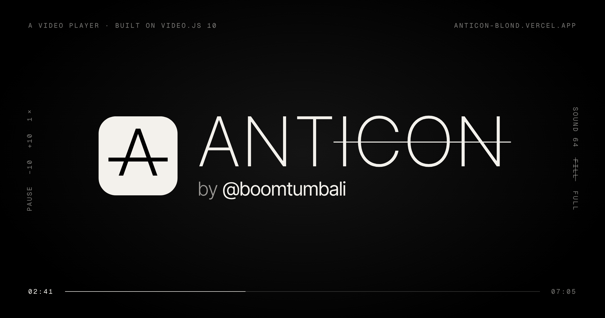
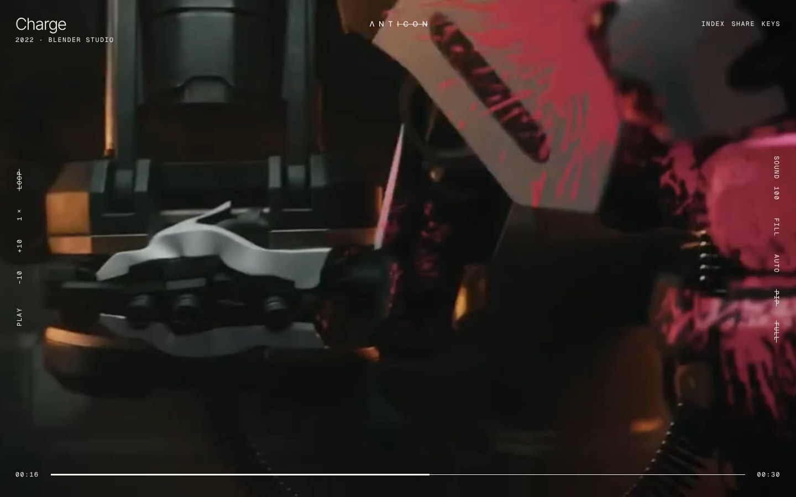
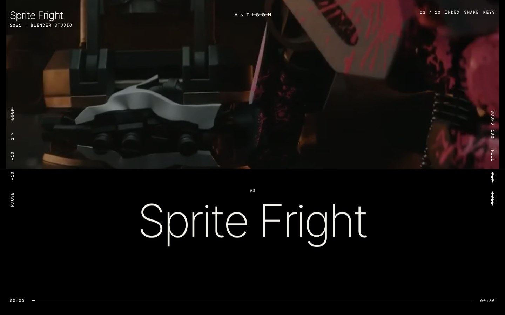
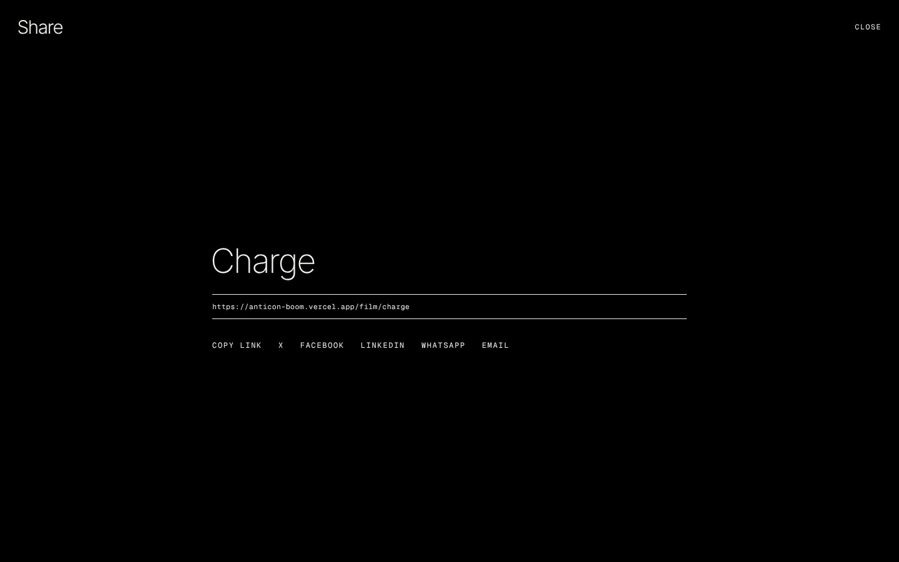
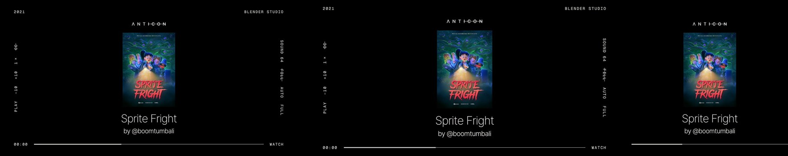

<p align="center"></p>

# ANTICON

**A video player without icons.** Every control is a word or a number, set in thin type. A control that can be on or off is a word: when it's off, a hairline runs through its middle; click it again and the line lifts. Progress is a single hairline with no knob. The words sit on the edges of the frame and run along each edge's own axis, so the player reads like a typographic poster rather than a toolbar.

Built on **Video.js 10** (`@videojs/react`) for the Video.js v10 Skins Challenge. Vibecoded by [@boomtumbali](https://contra.com/boomtumbali).

**Live:** [anticon-boom.vercel.app](https://anticon-boom.vercel.app) · **Source:** [github.com/boomtumbali/anticon](https://github.com/boomtumbali/anticon)

---

## A look

**The start page.** Nothing plays until you choose.


**The feed.** Words on the edges of the frame, each along its own edge's axis; one hairline for progress.



**Scrubbing.** The film's own frames run across the middle as one continuous strip; the frame on the centre line is the moment you point at.


**Moving between films.** The leaving film freezes on its frame and lifts away; the next rises with its name.



**Share.** The film's link, copied in one click or posted anywhere, with its own preview card.



**Share cards.** Every film has its own card, made to survive every crop: whatever a platform keeps (wide, 2:1, square), the title, the poster and the name stay; the player's edge words fill the wide sides.



**On a phone.** The start page, a film fitted on black, and the Index.


**Test.** Every screen size, and the pictures hardest to read over.


## Pages

| Path | What it is |
| --- | --- |
| `/` | Feed: the start page, then the feed: ten Blender Studio films, newest first, one per screen, under one player that stays put. They never run out: after the tenth comes the first again. |
| `/film/<id>` | A film's own link (for sharing): it previews with that film's card and opens the feed on it. |
| `/player/` | Test: one player at every screen size (phone, tablet, laptop, desktop, TV, embed) over the hardest pictures (white, paper, black, bars, half and half) and all ten films. It opens on Singularity, playing with sound, on your own kind of screen: Desktop on a computer; on a phone, Phone, which turns to Phone sideways the moment you turn the phone. On a phone, the player comes first and the choices slide sideways under it. |
| `/embed/` | Embed: the standalone player on an ordinary page, at 16:9, 9:16, 21:9, 4:3 and thumbnail size, with the code to use it. Every film waits at its middle, so each box already holds a picture; the first plays with sound, and starting another stops the one before. |

Every page has the same header (Feed, Test, Embed, Source, less the page you are on) and a **Light** word, struck through while the page is dark. The Feed opens dark; Test and Embed open light, so the player's edges show against the page. Once you choose, the choice holds on every page. The player itself stays dark. Embed and Test end with the same credits: Video.js, Mux, Blender Studio, the vibecoder.

## What the player does

- **Words on the edges.** Left edge, reading upward: Play, −10, +10, speed, CC, Loop. Right edge, reading downward: Sound with its volume number, Fill, quality, PiP, Cast, Full. Bottom: the time, the hairline, the length. Top: the title on the left, Share and Keys on the right (in the feed, Index too), all on one horizontal axis.
- **Adaptive by its own box.** Container queries, not the window. The words always stand up both edges, at every size; shorter boxes set them smaller and closer, and rest the less-used ones (their keys still work). A phone held sideways keeps everything but PiP and Cast; under 370 px tall, −10, +10, speed and Loop rest too; a thumbnail keeps Play, Sound and Full. Nothing overlaps at any size from a 300 px thumbnail to a TV.
- **One ink, solid.** Every word, number and line is solid white, or solid black where the picture under it is bright: a few times a second the skin reads the frame under each group of words and each group decides for itself. No greys, no shadows, no veils; hierarchy is size alone. Where a fitted film leaves a thin black band against a bright picture, the band grows, solid black, until it holds the words; a film only a hair off the box's shape fills it instead, so no sliver of band is left under a word.
- **The filmstrip.** While you scrub (drag the picture sideways, slide on a phone, or point at the progress line), a band opens across the middle holding the film's frames from Mux's storyboard. The pointed time sits left of the centre line, the length right of it. Dragging the picture scrubs exactly as the line does: same scale, and the film follows as you go.
- **Two halves, two jobs.** Up or down on the left half of the picture is the sound and nothing else, quick or held; the middle shows `SOUND 64`. Up or down on the right half scrolls: in the feed, to the next or previous film; on a page, the page. Sideways scrubs, from anywhere.
- **Taps and clicks, the YouTube way.** A click plays or pauses at once; a double-click is full screen; ten seconds is the arrow keys. On a phone, a tap in the middle plays or pauses at once; double-tap a side (its outer third) for ten seconds back or forward, and keep tapping for ten more each time; a side's single tap waits a moment for a second one.
- **Quality.** `AUTO`, or the size you chose (`1080P`, `720P` …); each click, or Q, steps through Auto and every size the stream offers, highest first.
- **Sheets.** Index (in the feed), Share and Keys open over the player in solid black, each with its name where the film's title sits and Close where the corner words sit; Esc closes them.
- **Share.** The Share word opens the link with one row of words: *Copy link*, X, Facebook, LinkedIn, WhatsApp and Email; phones also get *More* (their own share sheet). In the feed each film is shared as its own page, so a pasted link shows that film's poster card.
- **Captions.** CC shows the stream's own captions (Mux's), set by the skin rather than the browser, so they look the same everywhere: Inter Tight at a reading weight, warm white on a dark box that hugs each line. They sit just above the time and the line, and settle lower when the words fade. iOS full screen and picture in picture keep the system's own captions.
- **Answers in the middle.** Keys and taps answer in thin capitals, at a size you read and forget: `PLAY`, `1.5×`, `SOUND 40`. Ten seconds back or forward answers on its own side (left for back, right for forward), whether from a key, the −10 and +10 words or a double-tap, and steps taken one after another add up, as on YouTube: `+10`, `+20`, `+30`.
- **Sound by default.** Browsers allow sound after the first click, tap or key, so *Enter* and choosing a film start with sound. Arriving by scrolling or from a link, the film starts silent and says so; the first tap, click or key turns sound on and does nothing else. The volume you set carries from film to film.
- **Calm moves between films.** One film per wheel turn or swipe, whatever the trackpad does after. The leaving film freezes on its frame (no black flash) and the next fades up only once it has a real frame to show. The time and the line stay put through the move; they rest only when you do.

## Keyboard, mouse and touch

| Keys | Action |
| --- | --- |
| Space, K | Play or pause |
| ← → or J L | 10 seconds back or forward (Shift: 30); press again and it adds up |
| , . | One frame (pauses) |
| Home, End | The start, the end |
| 0 – 9 | Jump to 0 % … 90 % |
| ↑ ↓ | Volume |
| M | Sound on or off |
| Q | Quality |
| C | Captions |
| < > | Slower, faster |
| F, double-click | Full screen |
| I | Picture in picture |
| ? | Every key and touch |
| Esc | Close a sheet, the Index or Credits |

| Mouse | Action |
| --- | --- |
| Click the picture | Play or pause |
| Drag sideways | Scrub, with the film's frames (as the line does) |
| Drag up or down, left half | Volume |
| Drag up or down, right half | Next or previous film (feed), or the page |
| Wheel (feed) | Next or previous film |

| Touch | Action |
| --- | --- |
| Tap | Play or pause |
| Double-tap a side | 10 seconds back or forward (keep tapping for more) |
| Hold | Twice the speed while you hold |
| Slide sideways, or hold then slide sideways | Scrub |
| Slide up or down on the left half (quick or held) | Volume |
| Pinch | Out to fill, in to fit |
| Swipe up or down on the right half | Next or previous film (feed), or the page |

## Use it

```jsx
import { AnticonPlayer } from './player/AnticonPlayer.jsx';
import '@fontsource-variable/inter-tight';
import '@fontsource-variable/geist-mono';
import './brand.css';
import './anticon.css';

<AnticonPlayer
  playbackId="Mux playback ID"   // or src="film.mp4" or src="stream.m3u8"
  title="Sprite Fright"
  meta="2021 · Blender Studio"
  aspect="16 / 9"                // any ratio; null to size it yourself with style
/>
```

| Prop | Default | |
| --- | --- | --- |
| `playbackId` / `src` | | A Mux playback ID, or any MP4 or HLS URL |
| `title`, `meta` | | Top left |
| `poster` | Mux thumbnail | Shown until the film runs |
| `aspect` | `'16 / 9'` | `null` to size it with `style` |
| `autoPlay` | `false` | Starts with sound; where the browser allows sound only after a first tap, click or key, it plays silent, says so, and that first touch turns sound on |
| `start` | | Where the film waits: `'middle'`, or a time in seconds |
| `defaultFill` | `false` | Start filled (cover) rather than fitted |
| `corner` | | Anything for the top right, before Share and Keys |
| `storyboard` | the Mux storyboard | A storyboard address for the filmstrip |

The skin itself is `AnticonSkin` in `src/player/Skin.jsx`; the feed in `src/App.jsx` shows how a host adds a brand, a corner, sharing and its own media.

## Built with

- **Video.js 10:** `createPlayer` with `videoFeatures` (one store for play state, time, volume, rate, captions, quality, PiP, Cast, full screen), `Hotkey`, `StatusAnnouncer`, `useQualityOptions`, `useActiveTextCues` (the captions), input-action events, `MuxVideo` and `HlsJsVideo`.
- **Mux:** streaming, thumbnails, storyboards for the filmstrip, and Mux Data.
- **React 19** and **Vite**. Type: Inter Tight and Geist Mono, bundled.

## Run it

```bash
npm install
npm run dev        # http://localhost:5173
npm run build      # dist/
```

Deploys to Vercel as a Vite project; `vercel.json` routes `/player`, `/embed` and `/film/<id>`. After changing the films, `npm run film-pages` rewrites the films' share pages.

## The films

All by Blender Studio, released under Creative Commons, streamed through Mux. Newest first.

| # | Film | Year |
| --- | --- | --- |
| 01 | Singularity | 2026 |
| 02 | Charge | 2022 |
| 03 | Sprite Fright | 2021 |
| 04 | Coffee Run | 2020 |
| 05 | Spring | 2019 |
| 06 | Hero | 2018 |
| 07 | Agent 327: Operation Barbershop | 2017 |
| 08 | Tears of Steel | 2012 |
| 09 | Sintel | 2010 |
| 10 | Elephants Dream | 2006 |

## Credits

Vibecoded by [@boomtumbali](https://contra.com/boomtumbali). Built on [Video.js](https://videojs.com). Streams on [Mux](https://www.mux.com). Films by [Blender Studio](https://studio.blender.org).
